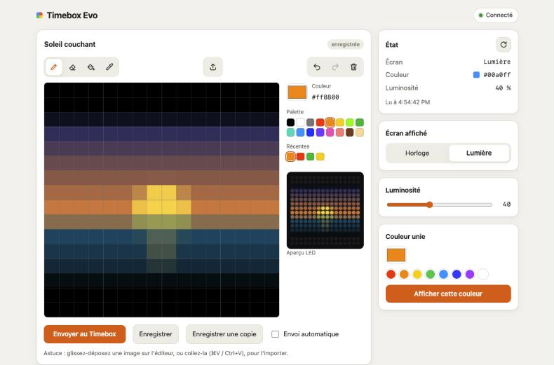

# pixel-studio

Drive a **Divoom Timebox Evo** (16×16 LED speaker) from a web browser: pixel editor, image import,
gallery and device controls, served by a [Pyronaut](https://pyronaut.io) application
(Python on GraalPy + Micronaut).



```
browser ──HTTP──> pixel-studio (Pyronaut, :8080) ──TCP──> timebox-bridge (:7777) ──Bluetooth RFCOMM──> Timebox Evo
```

The Timebox Evo is driven over **classic Bluetooth (SPP, RFCOMM channel 1)**. Bluetooth is handled
by a small native relay, [`bridge/macos`](bridge/macos/README.md), so the application itself only
talks plain TCP. See [`docs/architecture.md`](docs/architecture.md) (including the GraalPy
constraints that shaped the code) and
[`docs/protocol.md`](docs/protocol.md).

> Status: personal project, tested with one Timebox Evo on macOS. The UI and code comments are in
> French; this README and the docs are in English.

## Features

- **Pixel editor** — pencil, eraser, fill, color picker, undo/redo, palette and recent colors,
  live LED preview, manual or automatic sending, keyboard support.
- **Image import** — file picker, drag & drop or paste; crop (fill / fit / stretch); smooth
  (photos) or sharp (pixel art, auto-detected) downscaling to 16×16, done in the browser.
- **Gallery** — save, copy, rename, delete, send to the device (JSON files on disk).
- **Device controls** — state, clock / light view, brightness, solid color.
- **REST API** with OpenAPI / Swagger UI.

## Requirements

- macOS, with the Timebox Evo **paired** (System Settings → Bluetooth). The device shows up as
  `TimeBox-Evo-audio`.
- Xcode command line tools (`swiftc`) to build the relay.
- Python ≥ 3.10 and Pyronaut 0.1.0:

  ```bash
  python3 -m pip install 'pyronaut==0.1.0'
  pyronaut setup        # installs the matching GraalVM JDK and GraalPy under ~/.pyronaut
  ```

## Quick start

1. **Build and start the relay** — from the **Terminal** app, which must be allowed to use
   Bluetooth (macOS asks on first run):

   ```bash
   bridge/macos/build.sh
   bridge/macos/timebox-bridge --list                        # find your device address (→ marks Divoom devices)
   bridge/macos/timebox-bridge --address AA-BB-CC-DD-EE-FF   # add --verbose to see the bytes
   ```

   Wait for `écoute sur 127.0.0.1:7777` ("listening"). Close the Divoom phone app: it can hold
   the Bluetooth channel.

2. **Start the application**:

   ```bash
   pyronaut install      # once: creates the GraalPy .venv and resolves dependencies
   pyronaut run
   ```

3. Open **http://localhost:8080/**.

Check the relay without the application: `python3 tools/bridge-client.py 46` asks the device for
its state.

## Tests

```bash
pyronaut test
```

Pytest on GraalPy: protocol tests (bytes captured from the real device), end-to-end HTTP tests
with a fake device injected in place of the TCP transport (`@Replaces` + `@Requires(env="test")`),
gallery tests in a temporary directory.

## API

Interactive documentation: http://localhost:8080/swagger-ui/index.html

| Method | Path | Effect |
|--------|------|--------|
| GET | `/timebox/state` | decoded device state |
| POST | `/timebox/color/{rrggbb}?brightness=0..100` | solid color |
| POST | `/timebox/brightness/{0..100}` | brightness |
| POST | `/timebox/view/{clock\|light}` | displayed view |
| POST | `/timebox/image` | 16×16 image as JSON `{"pixels": [256 × "rrggbb"]}` |
| POST | `/timebox/image/png` | raw 16×16 image (PNG, GIF, BMP, JPEG) |
| GET | `/timebox/image` | last image sent (404 if none) |
| GET / POST | `/timebox/gallery` | list / create `{"name", "pixels"}` |
| GET / PUT / DELETE | `/timebox/gallery/{id}` | read / update / delete |
| POST | `/timebox/gallery/{id}/send` | display a gallery image |

Errors: 400 (invalid value), 404 (unknown image), 503 (relay unreachable or device silent).

```bash
curl -X POST "http://localhost:8080/timebox/color/ff8800?brightness=60"
curl -X POST -H "Content-Type: image/png" --data-binary @heart.png http://localhost:8080/timebox/image/png
```

## Configuration

`config/application.toml`, every key can be overridden with an environment variable
(e.g. `TIMEBOX_BRIDGE_PORT=7778 MICRONAUT_SERVER_PORT=8081 pyronaut run`).

| Key | Default | Purpose |
|-----|---------|---------|
| `timebox.bridge.host` / `port` | `127.0.0.1` / `7777` | relay address |
| `timebox.bridge.connect-timeout-ms` | `2000` | relay connection timeout |
| `timebox.reply-timeout-ms` | `2000` | wait for the device reply |
| `timebox.storage.dir` | `~/.pixel-studio` | gallery (`gallery/*.json`) and last image |

## Project layout

```
src/timebox/evo/
  protocol.py    Divoom frames, commands, image encoding (pure Python)
  transport.py   Transport (ABC) + TcpTransport (java.net.Socket)
  client.py      TimeboxClient: command → expected reply, shared Java lock
  storage.py     gallery and last image on disk
  imaging.py     image decoding with javax.imageio
  controller.py  REST API and error handling
config/public/   web UI (plain HTML/CSS/JS, no build step)
bridge/macos/    Bluetooth RFCOMM ↔ TCP relay (Swift)
tools/           bridge-client.py, a dependency-free test client for the relay
docs/            protocol and architecture notes
tests/           pytest
```

## Credits and license

Protocol knowledge comes from the community, see [CREDITS.md](CREDITS.md).
Not affiliated with Divoom. Released under the [MIT License](LICENSE).
